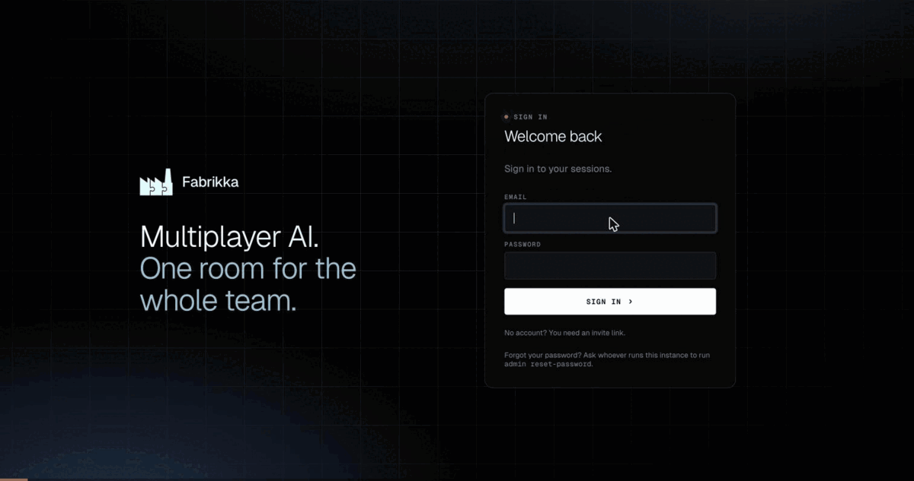
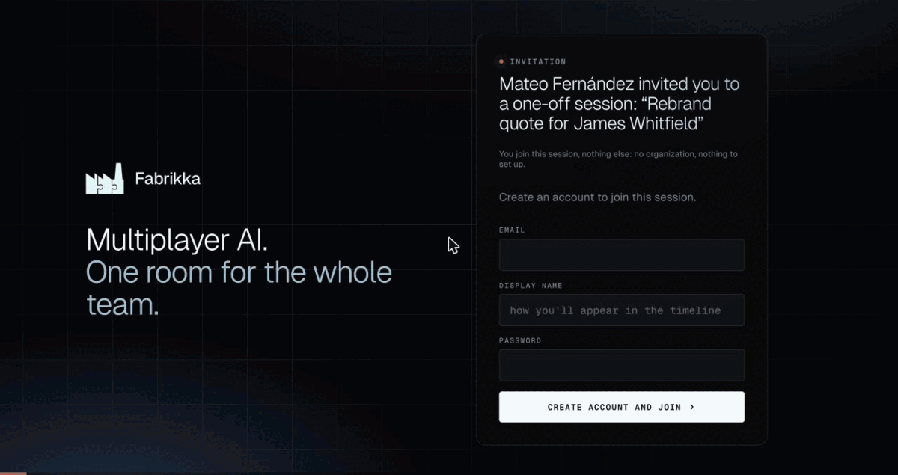
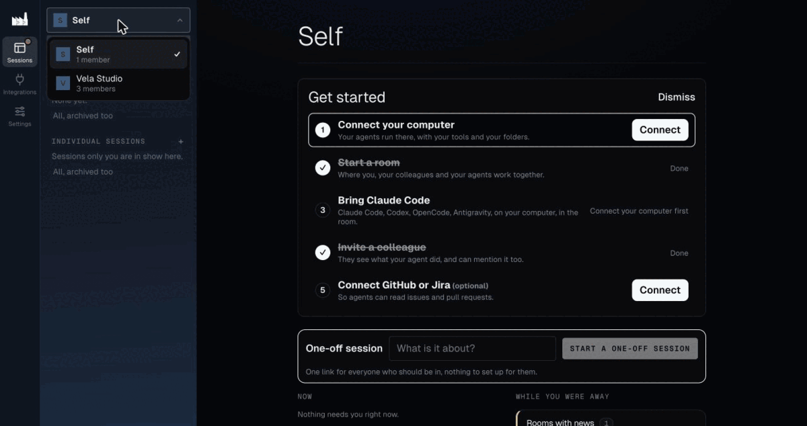
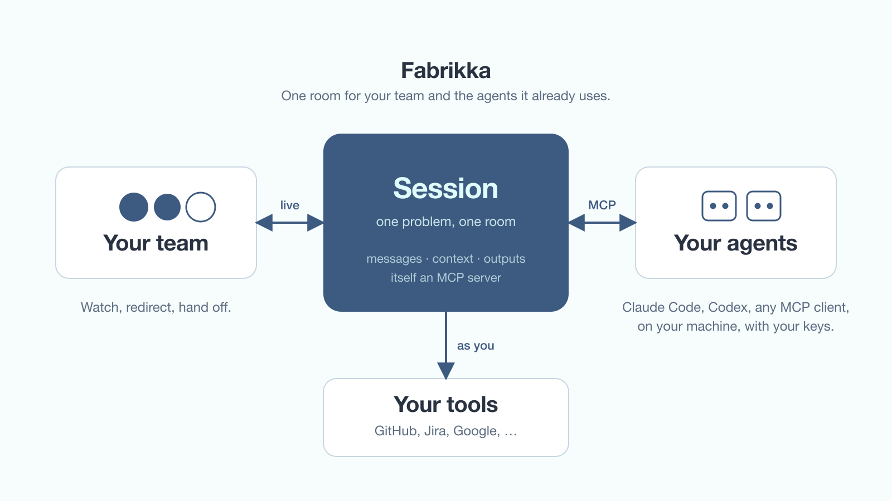

# Fabrikka

[](LICENSE)
[](docs/protocol.md)
[](#host-it-yourself)

[fabrikka.xyz](https://fabrikka.xyz) · [How agents join](#how-agents-join) · [Host it yourself](#host-it-yourself) · [Docs](#documentation) · [Security](SECURITY.md)

**Multiplayer AI.** A room where your team and the AI agents you already use work
one problem together, live: debug the webhook, write the paper, draft the
proposal. Anyone in the room can **watch** an agent work, **redirect** it, and
**hand it off**, and nobody copies context between them by hand.



<table>
  <tr>
    <td width="50%"></td>
    <td width="50%"></td>
  </tr>
  <tr>
    <td align="center"><sub><b>Join by link.</b> An invitee creates an account from a session link, picks her agents and a look, and lands in the session.</sub></td>
    <td align="center"><sub><b>A one-off session.</b> Start one from the home screen and share its link; nothing to set up for the others.</sub></td>
  </tr>
</table>

Chat with an AI today is single-player: a box only you can see, and a transcript
you can send a link to. Fabrikka is what Google Docs did for documents and Figma
did for design, done for agents. Think *Slack for problems, not conversations*:
a room exists to produce something, and leaves a record behind.

- **Bring your own agent.** Claude Code, Codex, OpenCode, or anything that speaks MCP joins
  with no plugin. Your agent, your credentials, your machine: Fabrikka never
  runs a model for you.
- **Private by default.** A room is invisible to anyone not in it.
- **Your tools, as you.** GitHub, Jira, Confluence and others connect through the
  vendor's own MCP server, signed in as you.
- **Host it yourself, free.** One click on Render, or `docker compose up` on any
  server. Licensed [AGPL-3.0](LICENSE).

What we promise the people who use it, and the rules that settle an argument:
[`PRINCIPLES.md`](PRINCIPLES.md).

## Status

**Pre-MVP, pre-1.0.** The road to MVP, phase by phase, is
[`docs/mvp.md`](docs/mvp.md). Built so far:
- rooms, mentions and live agent activity;
- agents joining live or on a mention;
- safety rails, shared documents and LaTeX papers;
- teams, guests, comments, catch-up and handoffs, templates, export;
- per-person connections to vendors;
- a desktop app that runs your agents in folders you choose;
- self-hosting (Docker, Render, Railway).

Every milestone, with its acceptance test, is in
[`docs/roadmap.md`](docs/roadmap.md).

## How it works



**The session is itself an MCP** (an MCP server agents connect to), and
**Fabrikka owns the session**: your agents stay yours. Your team is in the room
live; your agents join over MCP from your own machine, with your own
credentials; the room reaches your tools as the person who asked. The full
picture, lane by lane, is [`brand/architecture.png`](brand/architecture.png),
and the reasoning is in [`ARCHITECTURE.md`](ARCHITECTURE.md).

## How agents join

Two lanes, because MCP is pull-only and cannot address an idle agent (see [ADR 0003](docs/decisions/0003-hybrid-wake-up.md)).

**Lane A — remote endpoint.** Any MCP client, anywhere:

```bash
claude mcp add --transport http fabrikka \
  https://<host>/mcp/o/<owner_id>/s/<session_id> \
  --header "Authorization: Bearer <token>"
```

**Lane B — local bridge.** Real-time push into a Claude Code session you already have open. The agent spawns the bridge, never the reverse:

```json
{
  "mcpServers": {
    "fabrikka": {
      "command": "fabrikka",
      "args": ["connect"],
      "env": { "FABRIKKA_URL": "<session endpoint>", "FABRIKKA_TOKEN": "<token>" }
    }
  }
}
```

```bash
claude --dangerously-load-development-channels server:fabrikka
```

When a mention arrives, a live bridge connection gets a channel push; otherwise a headless run is spawned. Full contract in [`docs/protocol.md`](docs/protocol.md).

**Your computer, once.** Every instance serves its own client (Node 22+). Copy
the command from *Your devices*:

```bash
curl -fsSL https://<your instance>/install.sh | bash
```

It installs `fabrikka` into your home folder, then opens the pairing page. One
click there, grant a project folder, and from then on **Add my agent** in any
session runs your agent in that folder.

## Host it yourself

On Render: **New → Blueprint →** this repository **→ Apply**, then open the URL
and create the owner (`render.yaml`, details in
[`docs/operations.md`](docs/operations.md#deploy-on-render-m40)).

On any server with Docker and a domain: `cd docker/selfhost && ./init.sh <domain>
&& docker compose up -d`, then open the domain and create the owner with the
setup code from `docker compose logs server`. Details, backups and upgrades:
[`docs/operations.md`](docs/operations.md#self-hosting-with-docker-m39).

## Development

Requires Node 22+, pnpm and Docker. **No mail server** — see
[ADR 0007](docs/decisions/0007-email-is-a-transport.md).

```bash
cp .env.example .env
pnpm install
pnpm db:up
pnpm dev          # web on :5173, server on :9090; migrations run at start
```

Open the app: a fresh instance sends you to **Set up Fabrikka**, where the setup
code printed by the server creates the first owner. There is no open
registration after that.

Then invite people with a **link**, not an email: open a session, *Create invite
link*, and send it however you like. Forgot a password?
`pnpm admin reset-password --email <e>`. See [`docs/operations.md`](docs/operations.md).

## Documentation

**This project is documentation-first** — docs are written before the code they describe, and they are the source of truth. See [`CLAUDE.md`](CLAUDE.md).

| Doc | Holds |
| --- | --- |
| [`PRINCIPLES.md`](PRINCIPLES.md) | What the user gets, the current bet, the ground rules |
| [`ARCHITECTURE.md`](ARCHITECTURE.md) | The rule, the layers, the hybrid wake-up design |
| [`docs/protocol.md`](docs/protocol.md) | **The contract external agents bind to** |
| [`docs/security.md`](docs/security.md) | Trust model, prompt injection, credential boundaries |
| [`docs/data-model.md`](docs/data-model.md) | Schema and what each table is for |
| [`docs/operations.md`](docs/operations.md) | Running an instance: bootstrap, admin CLI, invites, backups |
| [`docs/themes.md`](docs/themes.md) | Themes: choosing one, and making your own |
| [`docs/roadmap.md`](docs/roadmap.md) | Milestones M0–M44 and their acceptance tests |
| [`docs/decisions/`](docs/decisions/) | ADRs — why each of the above is the way it is |

## License

[GNU AGPL v3](LICENSE) (`AGPL-3.0-only`). Fabrikka is free software: use it,
self-host it, change it. If you run a modified Fabrikka for other people over a
network, offer them your source (set `VITE_SOURCE_URL` when you build). License:
[ADR 0034](docs/decisions/0034-license-agpl-3.0.md).
Contributions are under the [contributor agreement](CONTRIBUTING.md).
